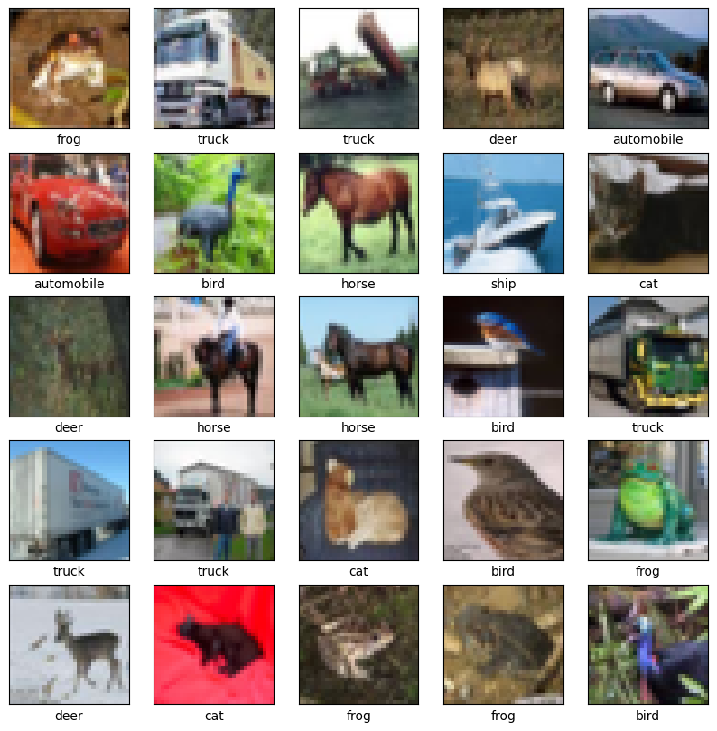
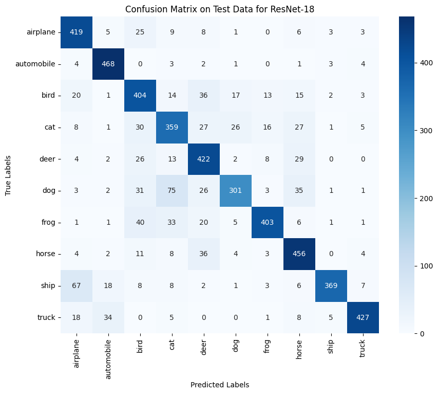
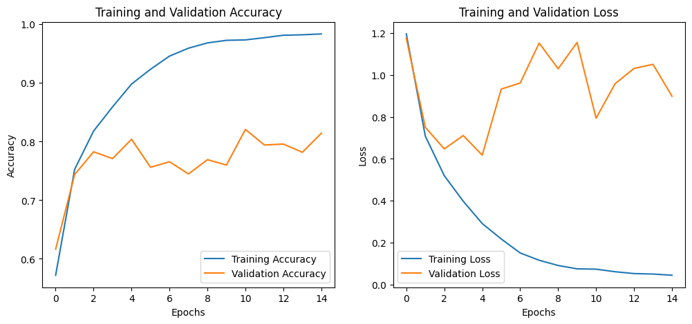

# Three networks, one image test: CNNs on CIFAR-10

Could a computer tell a frog from a truck in a picture smaller than a postage stamp? I built three image-recognition networks from scratch, gave them the same 50,000 training pictures, and let them compete.



*Each picture is only 32 × 32 pixels. Some are hard to make out even for a person.*

## The leaderboard

| Rank | Network | Size (adjustable values) | Accuracy on unseen pictures |
|---:|---|---:|---:|
| 1 | ResNet-18 | 11.2 million | **79.0%** |
| 2 | SimpleCNN | 0.16 million | 72.6% |
| 3 | AlexNet | 36.9 million | 71.7% |

*Validation set of 5,000 pictures. A network that guessed at random would score 10%.*

ResNet-18 won, so I fine-tuned it. On 5,000 brand-new test pictures, the tuned version labelled **80.6% correctly**, about 4 out of every 5.

Size is not what decided the ranking. AlexNet has more than three times as many adjustable values as ResNet-18 and came last. SimpleCNN, which is over 200 times smaller than AlexNet, beat it slightly. How a network is put together matters more than how big it is.

## The dataset

CIFAR-10 is a standard benchmark of 60,000 small colour photos, split evenly across 10 classes: airplane, automobile, bird, cat, deer, dog, frog, horse, ship and truck. I used 50,000 pictures to train, 5,000 to compare the networks and 5,000 for the final test.

## How a CNN sees a picture

A convolutional neural network (CNN) slides small filters across the image, a few pixels at a time. The first layers learn to notice simple things, like edges and patches of colour. Later layers combine those into bigger patterns, like a wheel, an eye or a wing. The last layer turns all of that into a vote across the 10 classes.

The three contestants:

- **ResNet-18** is 18 layers deep. Deep networks are normally hard to train, because the learning signal fades on its way back through the layers. ResNet adds shortcuts that let the signal skip layers, so it can go deep and still learn.
- **AlexNet** is the 2012 network that started the deep-learning boom in image recognition. Most of its size sits in two huge final layers. I scaled down its filters to suit tiny images.
- **SimpleCNN** is my own minimal design: three filter layers and one small decision layer. It is there as a baseline.

## Where the winner gets confused



*Each row is the true class and each column is what the model said. The diagonal is correct answers.*

- **Vehicles were easy.** It got 96% of automobiles and 86% of trucks right.
- **Animals were harder.** Cats and dogs were its weakest classes.
- **The single most common mistake was calling a dog a cat.** It did that 75 times out of 478 dogs.
- **Ships became airplanes 67 times.** My guess is the blue background: open sky and open water look alike at this size.

## How tuning went

I tested every combination of two learning speeds, two batch sizes and two training methods (Adam and SGD), eight runs in total. The best mix was Adam, a learning rate of 0.0005 and batches of 64 pictures.

Two things stood out:

- **The untuned ResNet-18 memorised.** It scored 95.7% on pictures it had trained on but 79.0% on new ones. Showing it flipped and shifted copies of the training images (data augmentation) is the standard fix, and the next thing I would add.
- **The same settings gave different scores on different runs.** The winning mix scored 85.5% during the search and 80.4% when I retrained it. A 5-point swing between identical runs is larger than most of the differences the search was trying to measure. Running each setting several times would separate real gains from luck.



<details>
<summary><b>Technical details</b></summary>

**Data.** `keras.datasets.cifar10`. The 10,000-image test split was divided 50/50 into validation and test with `random_state=42`. Pixels scaled to [0, 1]. No augmentation.

**Architectures** (all built from scratch in Keras):

| Model | Layers |
|---|---|
| ResNet-18 | 3×3 conv (64) + BN + ReLU, then 8 basic residual blocks with 64, 128, 256, 512 filters (strides 1, 2, 2, 2; 1×1 projection shortcuts when downsampling), global average pooling, softmax |
| AlexNet (adapted) | Five 3×3 convs (96, 256, 384, 384, 256) with three 2×2 max pools, then Dense 4096, Dense 4096 (each with dropout 0.5), softmax |
| SimpleCNN | Conv 32, 64, 128 (3×3) each followed by 2×2 max pooling, Dense 128 with dropout 0.5, softmax |

**Training.** Sparse categorical cross-entropy, Adam (lr 0.001), batch 64, up to 50 epochs. `ReduceLROnPlateau` (factor 0.5, patience 5, min 1e-6) and `EarlyStopping` (patience 10, best weights restored), both on validation loss.

**Baseline results** (at the epoch early stopping kept):

| Model | Train accuracy | Validation accuracy |
|---|---:|---:|
| ResNet-18 | 0.957 | 0.790 |
| AlexNet | 0.806 | 0.717 |
| SimpleCNN | 0.782 | 0.726 |

**Tuning.** Grid over learning rate {0.001, 0.0005} × batch size {64, 128} × optimiser {SGD with momentum 0.9, Adam}. Best: Adam, 0.0005, 64 (validation accuracy 0.855 during the search).

**Final model.** Retrained with the best settings: validation accuracy 0.804, test accuracy 0.806, test loss 0.622, macro F1 0.81. The notebook saves it as `best_resnet18_model.keras`, which is not committed.

**Randomness.** No seed is set.

</details>

## Files

| File | What's inside |
|---|---|
| [`cnn_image_classification.ipynb`](cnn_image_classification.ipynb) | Every step, from loading the data to the final test, with outputs |
| [`report/cnn_image_classification_report.pdf`](report/cnn_image_classification_report.pdf) | My write-up as a conference-style paper |
| `figures/` | Sample images, class balance, training curves for all three networks and the final confusion matrix |
| [`references.bib`](references.bib) | Sources cited in the paper |

## Run it yourself

```bash
pip install -r ../requirements.txt
jupyter lab cnn_image_classification.ipynb
```

Use a GPU. I ran this on a Google Colab A100, and the notebook trains ten versions of ResNet-18, which would take many hours on a laptop. The dataset downloads automatically.

Built with Python, TensorFlow/Keras, scikit-learn, NumPy, Matplotlib and seaborn.
