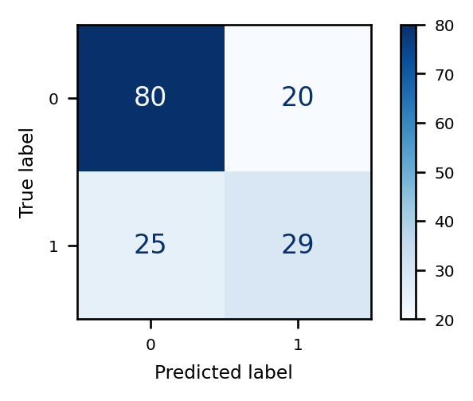
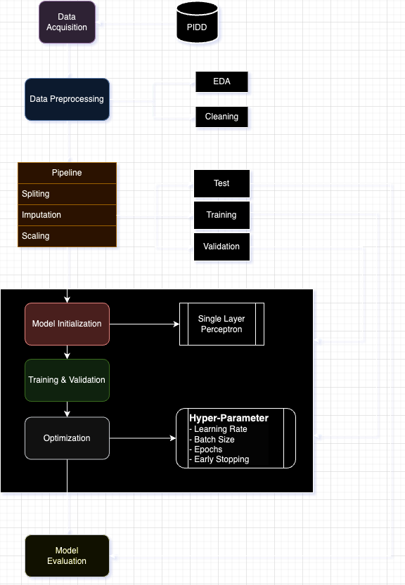
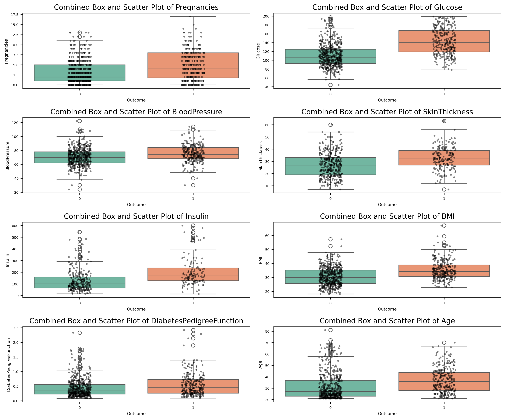

# Can a single artificial neuron spot diabetes?

A perceptron is the smallest possible neural network: one artificial neuron. In this project I trained one on medical records from 768 women of Pima Indian heritage and asked it a yes-or-no question. Does this patient have diabetes?

I wanted to understand how a model this simple behaves, and what changes when you adjust the way it learns. High accuracy was not the goal.

## The short answer

On 154 patients it had never seen, the neuron was right **71% of the time**.

| Out of 154 test patients | Count |
|---|---:|
| Had diabetes and the model caught it | 29 |
| Had diabetes and the model missed it | 25 |
| Did not have diabetes and the model agreed | 80 |
| Did not have diabetes but the model flagged them (false alarm) | 20 |

So it caught just over half of the people with diabetes. That is respectable for one neuron and not good enough for a real screening test, where a missed case matters more than a false alarm.



*Rows are the truth, columns are the model's answer. 0 means no diabetes, 1 means diabetes.*

## How the neuron makes a decision

Think of it as a weighted checklist. The neuron looks at eight measurements:

- number of pregnancies
- blood glucose
- blood pressure
- skin-fold thickness
- insulin
- BMI
- a family-history score (diabetes pedigree function)
- age

Each measurement gets a weight that says how much it should count. The neuron adds them up and turns the total into a risk score between 0 and 1. A score above 0.5 means "diabetes".

Training is the process of finding good weights. The model guesses, sees how wrong it was, nudges the weights, and repeats, a few dozen patients at a time.



## The data had hidden gaps

At first glance nothing was missing. Every cell had a number. But some of those numbers were zeros that cannot be real. Nobody has a BMI or a blood glucose of 0. The zeros meant "not measured".

| Measurement | Values I treated as missing | Share of patients |
|---|---:|---:|
| Insulin (0, or above 650) | 377 | 49% |
| Skin thickness (0, or above 65) | 228 | 30% |
| Blood pressure | 35 | 5% |
| BMI | 11 | 1% |
| Glucose | 5 | 1% |

Insulin was missing for almost half the patients. I filled the gaps with MICE imputation, which estimates each missing value from the patient's other measurements.



*After cleaning. Green is patients without diabetes, orange is patients with it. Glucose shows the clearest gap between the two groups.*

## Practice exam, final exam

I split the patients three ways:

- **Training set (460 patients).** The model learns from these.
- **Validation set (154).** The practice exam. I used it to compare settings and pick the best.
- **Test set (154).** The final exam, used once at the very end.

The first version scored 78% on the practice exam. I then tried 16 variations, changing one setting at a time, and the best reached **83%**. On the final exam that same model scored **71%**.

That drop is the most useful thing this project taught me. When each version is tried once on a small practice exam, the winner is partly the one that got lucky. A fairer contest would repeat each version several times, or rotate which patients sit the practice exam (cross-validation).

## Full results

| Metric | What it means | First version (practice) | Final model (test) |
|---|---|---:|---:|
| Accuracy | Share of all answers that were right | 77.9% | 70.8% |
| Recall | Share of diabetic patients it caught | 57.4% | 53.7% |
| Precision | When it said "diabetes", how often it was right | 73.8% | 59.2% |
| Balanced accuracy | Accuracy with both groups counted equally | 73.2% | 66.9% |
| F1 score | Balance of recall and precision | 0.646 | 0.563 |
| AUC | Chance it ranks a random diabetic patient above a random non-diabetic one | 0.866 | 0.813 |

An AUC of 0.81 means the risk scores carry real signal, even though the 0.5 cut-off misses many cases. Lowering the cut-off would catch more people with diabetes, at the price of more false alarms.

<details>
<summary><b>Technical details</b></summary>

- **Data.** Original Pima Indians Diabetes dataset, 768 rows, 268 positive. I used the raw version rather than a pre-cleaned one so that cleaning decisions stayed inside my pipeline.
- **Split.** 60/20/20, stratified on `Outcome`, `random_state=42`.
- **Preprocessing.** `IterativeImputer` (MICE) followed by `StandardScaler`, both fitted on the training set only.
- **Model.** Keras `Dense(1, activation="sigmoid")`, binary cross-entropy, Adam, batch size 32, up to 100 epochs, early stopping on validation loss with patience 10 and best weights restored.
- **Tuning.** One factor at a time, 16 runs in total: learning rate {0.1, 0.01, 0.001, 0.0001}, batch size {16, 32, 64, 128}, max epochs {50, 100, 150, 200}, early-stopping patience {5, 10, 15, 20}. The best was patience 5 (validation accuracy 0.831).
- **Metrics.** Accuracy, balanced accuracy, recall, precision, F1, F-beta (beta 0.1 and 10) and ROC AUC.
- **Randomness.** No seed is set, so re-running gives slightly different numbers.

</details>

## Files

| File | What's inside |
|---|---|
| [`perceptron_diabetes_prediction.ipynb`](perceptron_diabetes_prediction.ipynb) | The full analysis with all outputs |
| [`report/perceptron_diabetes_prediction_report.pdf`](report/perceptron_diabetes_prediction_report.pdf) | My write-up as a short conference paper |
| [`data/diabetes.csv`](data/diabetes.csv) | The dataset |
| `figures/` | Charts from the notebook and the workflow diagram (with its draw.io source) |
| [`references.bib`](references.bib) | Sources cited in the paper |

## Run it yourself

This one runs on any laptop in a few minutes.

```bash
pip install -r ../requirements.txt
jupyter lab perceptron_diabetes_prediction.ipynb
```

Open the notebook from this folder so it can find `data/diabetes.csv`.

Built with Python, TensorFlow/Keras, scikit-learn, pandas, Matplotlib and seaborn.
