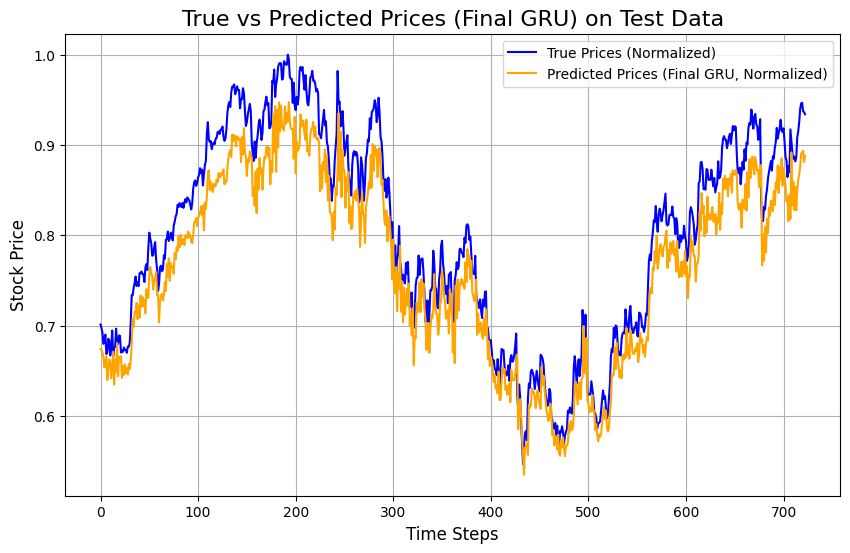

# What I learned trying to predict Google's share price

I trained three kinds of recurrent neural network on 19 years of Google's daily share price. Each one looked at the last 30 trading days and guessed the next day's closing price. Then I tested the best one on 2021 to 2023, a period it had never seen.

In short, the models followed the price closely, typically within a few dollars. They could not tell whether the price would go up or down the next day any better than a coin toss. And the model I spent the most effort tuning ended up as the worst of the bunch.



*Blue is the real price and orange is the model's prediction, scaled to a 0 to 1 range. The model follows every major move but sits a little below the real price for most of the period.*

## Questions and answers

### How close did the predictions get?

Close in dollar terms. On the 2021 to 2023 test period, when the share traded between roughly \$80 and \$150:

| Model | Typical daily error (RMSE) |
|---|---:|
| GRU, untuned | **$2.36** |
| GRU, tuned (my final model) | $6.21 |

RMSE is a kind of average miss that punishes big misses more than small ones.

### So it works?

Not as well as those numbers suggest. Tomorrow's price is almost always close to today's, so even "tomorrow will be the same as today" gives a small error. I did not include that simple guess as a benchmark, and it is the first thing I would add. Without it, a low error does not prove the network learned anything useful.

### Can it tell whether the price will rise or fall?

No. I measured how often the predicted move went the same way as the real one (mean directional accuracy, MDA). Every model landed between 46% and 51%, the range you would expect from flipping a coin.

### Why did tuning make things worse?

I tried 10 random combinations of settings and kept the one with the lowest error on 2020 data. But even that winner was worse on 2020 than the GRU with default settings, and on the test years it was more than twice as far off. Ten random tries were too few to beat the defaults. The winner also used a learning rate ten times higher than normal, which makes training jumpy.

### Was the test fair?

Mostly, with one flaw. Before training, I rescaled every price to a 0 to 1 range using the lowest and highest prices across all 19 years. The highest price happened in late 2021, inside the test period. So the model was set up with one piece of information from the future. Rescaling with the training years only would fix that.

## The three networks

Ordinary neural networks look at all their inputs at once. Recurrent networks read them in order, one day at a time, and carry a running memory forward. That makes them a natural fit for anything that unfolds over time.

- **Simple RNN.** The basic version. Its memory fades quickly, so it struggles to use information from many days back.
- **LSTM** (long short-term memory). Adds gates that decide what to remember, what to forget and what to pass on. It holds on to information much longer.
- **GRU** (gated recurrent unit). A lighter version of the LSTM with fewer gates. It often matches the LSTM while training faster.

How they compared on 2020, before any tuning:

| Model | Typical daily error | Direction right |
|---|---:|---:|
| Simple RNN | $2.27 | 50.5% |
| LSTM | $1.81 | 46.8% |
| GRU | **$1.64** | 46.4% |

The GRU had the smallest error, so it went forward to tuning and testing.

## The data

Daily prices for Google (ticker GOOG) from Yahoo Finance, from its stock market debut on 19 August 2004 to 29 December 2023. That is 4,875 trading days. The models used two inputs, the adjusted closing price and the number of shares traded, and predicted the next day's adjusted close.


I split the data by time, never at random, so the model always learned from the past and was tested on the future:

| Period | Use | Trading days |
|---|---|---:|
| 2004 to 2019 | Training | 3,869 |
| 2020 | Comparing models and settings | 253 |
| 2021 to 2023 | Final test | 753 |

<details>
<summary><b>Technical details</b></summary>

**Features and target.** `Adj Close` and `Volume`, min-max scaled to [0, 1] (scaler fitted on the full series). Sliding windows of 30 days predict the next day's `Adj Close`. This gives 3,839 training, 223 validation and 723 test sequences.

**Baseline models.** `SimpleRNN(64)`, `LSTM(64)` and `GRU(64)`, each followed by `Dense(1)`. Adam (default learning rate), MSE loss, 50 epochs, batch size 32.

**Validation results (scaled prices).**

| Model | MSE | RMSE | MDA |
|---|---:|---:|---:|
| Simple RNN | 0.000235 | 0.0153 | 0.505 |
| LSTM | 0.000149 | 0.0122 | 0.468 |
| GRU | 0.000124 | 0.0111 | 0.464 |

**Model selection.** Weighted score of 0.5 × (1/MSE) + 0.3 × (1/RMSE) + 0.2 × MDA. GRU scored highest.

**Random search.** 10 samples (`ParameterSampler`, `random_state=42`) from units {32, 64, 128}, layers {1, 2}, dropout {0.1, 0.2, 0.3}, batch size {16, 32, 64}, learning rate {0.001, 0.01, 0.1}, epochs {20, 50, 100}. Best: 1 layer, 64 units, dropout 0.1, learning rate 0.01, batch 64, 100 epochs (final validation loss 0.000148).

**Test results (scaled prices).**

| Model | MSE | RMSE | MDA |
|---|---:|---:|---:|
| GRU, untuned | 0.000255 | 0.0160 | 0.514 |
| GRU, tuned | 0.001766 | 0.0420 | 0.486 |

Dollar figures in this README are the scaled RMSE multiplied by the scaler's range (\$2.48 to \$150.34).

**Randomness.** No seed is set.

</details>

## Files

| File | What's inside |
|---|---|
| [`rnn_stock_price_prediction.ipynb`](rnn_stock_price_prediction.ipynb) | The whole study with outputs |
| [`report/rnn_stock_price_prediction_report.pdf`](report/rnn_stock_price_prediction_report.pdf) | My write-up as a conference-style paper |
| `figures/` | Data exploration charts, diagrams of the three networks and prediction plots |
| [`results/predicted_vs_true_prices.csv`](results/predicted_vs_true_prices.csv) | Simple RNN predictions against real prices in US dollars for 2020. It comes from a separate run, so the numbers differ slightly from the notebook |
| [`references.bib`](references.bib) | Sources cited in the paper |

## Run it yourself

```bash
pip install -r ../requirements.txt
jupyter lab rnn_stock_price_prediction.ipynb
```

The notebook downloads the price data, so it needs an internet connection. Newer versions of `yfinance` no longer return an `Adj Close` column by default. If yours doesn't, add `auto_adjust=False` to the `yf.download(...)` call.

These networks are small, so a laptop CPU is fine. I used a Colab GPU only for speed.

*This project is a learning exercise, not investment advice.*

Built with Python, TensorFlow/Keras, scikit-learn, yfinance, pandas, Matplotlib and seaborn.
